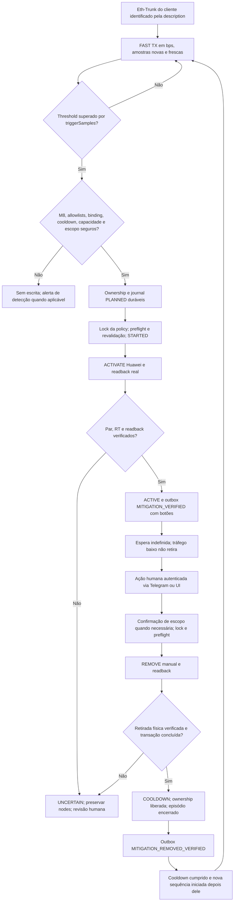

# IMPLANTAR — plano vigente: AUTO ACTIVATE + MANUAL REMOVE

> Atualização Fase 0.1 (29/10/2026): a API efetiva já é e78638a, com AUTO/persistência/lifecycle/REMOVE desligados. A aceitação estrita da Fase 0 continua NO-GO. O grafo systemd propaga restart da API ao MCP; o antigo roteiro de restart exclusivo não está liberado. Aplicam-se os gates, isolamento de WEB responsiva, diagnóstico do catálogo e rollback em [PHASE01_STABILIZATION.md](PHASE01_STABILIZATION.md). n8n RC7.1.2 já está publicado; nenhuma alteração n8n faz parte desta estabilização. Nova publicação/restart/migration/piloto exige autorização separada.

O operador decide exclusivamente o retorno do tráfego pelo Telegram ou UI. Este documento substitui o plano E2E anterior. Nenhuma etapa autoriza AUTO REMOVE. Nenhuma ação operacional foi executada nesta preparação.



## Contrato e barreiras

- Instalação IMPLANTAR; lifecycle e persistência explicitamente habilitados; M8 verificável; allowlist de perfil e dispositivo explícitas; maxActive=1 no piloto. VNT/Fibinet são recusados pelo lifecycle.
- InterfaceId único no device correto, ifIndex positivo, Eth-Trunk UP, nome não ambíguo, cliente/banda derivados da description/alias canônico, direção explícita, banda persistida consistente. Não usar velocidade física do trunk como banda contratada. Reject de descrição de mitigação, scrub, uplink ou sem banda reconhecida. Override de banda continua explícito e auditável.
- Piloto conservador somente TX/FAST. RX é resolvido e recusado para escrita AUTO; não inverter RX/TX automaticamente. Mudança de interface, descrição, cliente, banda, direção, peers, family, RT ou par altera revision e impede uso da ownership antiga.
- Telemetria com idade e gap máximos de 15 s. Trigger estritamente `tráfego > banda efetiva × triggerPercent / 100`, não `>=`; `triggerSamples` amostras distintas. Revalidar frescor após preflight, antes da escrita. Amostra stale/ausente/duplicada não vale como sequência nova.
- Scope físico é device+policy. Policies compartilhadas e outra família AUTO na mesma interface são bloqueadas nesta versão conservadora. Todos os preflights, prefix-lists, lock, family contention e readbacks canônicos continuam obrigatórios. Runtime NORMAL nunca substitui readback nem permite adotar mitigação preexistente.
- O coordenador só despacha o literal ACTIVATE. Serviço canônico rejeita REMOVE com origin=AUTO, prefixo automático, autoEvidence ou autoOperationId antes de qualquer SSH. REMOVE=1 é inválido; produção exige REMOVE=0 literal. Não há fonte de recuperação, minHold ou caminho de timer para retirada. `recoverySamples` remanescente serve apenas à observação/fechamento de episódio de detecção sem mitigação; não autoriza escrita.
- Ownership ACTIVE/MANUAL/UNCERTAIN bloqueia novas ativações indefinidamente. Após REMOVE humano, somente readback real verificado + runtime sincronizado + transação de resultado/outbox liberam ownership. Falha de DB após SSH preserva bloqueio. Cooldown mínimo 60 s, default 600 s; a primeira amostra da nova sequência deve ser posterior ao fim do cooldown e à retirada.

## Persistência, restart e notificações

Mantida a migration aditiva `20261029090000_auto_lifecycle_durable` herdada do candidato E2E; nenhuma migration adicional para a correção de escopo. RC13 ainda não tem essa tabela. Não aplicar em produção nesta missão.

Tabela `MitigationAutomationRecord`: ownership, journal AUTO ACTIVATE e comandos manuais, episódios, aliases, outbox e recibos. Transações curtas com advisory lock de automação; nenhum SSH/HTTP dentro dessas transações. Lock canônico da policy cobre preflight/escrita/readback e commit de ownership/journal/outbox. Tokens de confirmação e credenciais não são gravados no journal.

Manual STARTED/UNCERTAIN nunca é repetido após restart pelo mesmo requestId. VERIFIED permite recibo durável sem repetir SSH ou estender cooldown. Mudança de action/profile/scope com mesmo ID é recusada pelo journal. ACTIVE exige readback de reconciliação; ACTIVATE interrompido vira UNCERTAIN. Intents antigos REMOVING ficam em quarentena, sem replay. Configuração/revision divergente exige revisão humana; não apagar records para liberar escrita. Falha de inicialização da persistência não habilita AUTO.

Outbox e estado são atômicos; ACK é separado e não é fabricado. HTTP exige 2xx + `delivered=true`; `X-NetVision-Token` outbound não substitui Authorization/Bearer dos comandos de retorno. Preservar os três nodes HTTP de Command/Scope Confirm/Scope Cancel e seus segredos. O botão de retirada continua somente no ramo MITIGATION_VERIFIED; aviso de detecção, retirada já verificada e falha não têm botões de retirada.

Entrega at-least-once: queda após Telegram aceitar e antes de gravar ACK pode duplicar aviso. IDs estáveis, lease 60 s, retry 30–600 s, 12 tentativas e FAILED retido; rate limit de detecção 30 min por perfil persiste. Falha de entrega não retira mitigação. Pendências e FAILED exigem revisão, sem apagar evidência.

O patch proposto `n8n/AUTO-DDOS-STATUS-OUTBOUND-PATCH.json` deriva do fixture RC7.1 disponível, não do export RC7.1.1 publicado. Deve ser mesclado e revisado no export real pelo operador. Teste n8n isolado usa Code sinks e credenciais falsas; não é Telegram físico homologado.

## Fase 0 — API-only, AUTO=0

Exige autorização futura de deploy/restart. Não usar `deploy/update.sh`, que compila/reinicia outros componentes.

1. Revalidar release/PID/CWD/hash API efetiva e78638a, WEB/BUILD_ID, MCP, health 200, configuração efetiva dos 23 drop-ins + unit e 12 EnvironmentFiles (recontar na janela), disco e contagens de eventos. Interromper com divergência não explicada, serviços instáveis, health !=200, disco <5 GiB ou insuficiente para duas cópias +2 GiB.
2. Selecionar SHA completo da implementação corrigida e worktree limpa. Fazer build API-only Linux com Node 24.19/lockfile, `npm ci --workspace @gmj/api --include-workspace-root --ignore-scripts --no-audit --no-fund` e `npm run build -w @gmj/api`. Validar hashes, runtime Prisma Linux e pacote. Não reutilizar artefato do E2E bdc3514 como release corrigida.
3. Nova release isolada; não escrever na RC13 ativa nem `/opt/GMJ-NetVision`. Backup protegido e restaurável de unit/drop-ins/EnvironmentFiles antes da troca. Novo drop-in proposto deve ordenar após o último RC13, com reset apenas de ExecStart e CWD da API e último EnvironmentFile dedicado. Validar ordenação e precedência dos arquivos, não somente o nome do drop-in. Exemplos em `deploy/` não foram instalados.
4. Configuração fase 0: `NETVISION_INSTALLATION_ID=IMPLANTAR`, `MITIGATION_AUTO_PERSISTENCE_ENABLED=0`, `MITIGATION_AUTO_LIFECYCLE_ENABLED=0`, `MITIGATION_AUTO_EXECUTION_ENABLED=0`, **`MITIGATION_AUTO_REMOVE_ENABLED=0`**, sweep/description promotion=0, allowlist de execução de perfis vazia e maxActive=1. Preservar demais flags FAST, executor Huawei e permissões manuais aprovadas. Não executar migration se não autorizada separadamente.
5. Só após nova autorização e gates da Fase 0.1: validar unit e precedência. Na topologia atual, exigir janela conjunta API+MCP explicitamente autorizada; restart estritamente API-only permanece NO-GO. Não usar ignore-dependencies em produção com base apenas no teste simulado. Revalidar em até 60 s PID/CWD/hash, health demoMode=false/snmpPolling=true, NRestarts, flags reais em `/proc/PID/environ` e endpoint autenticado `/api/bgp/mitigation/auto/lifecycle` com removalPolicy=MANUAL_ONLY/removeEnabled=false. WEB/observer intactos; MCP deve permanecer no escopo explicitamente aprovado e retornar saudável; nenhuma ativação/retirada nova. Caches exigem aquecimento/discovery após restart; ausência de snapshot impede avanço.

## Fase 1 — migration e homologação física dedicada

Autorizações separadas para migration aditiva, revisão do n8n real, restart e operações físicas de um perfil/escopo/janela definidos. Conferir checksums históricos LF/CRLF contra a release RC13, única migration nova pendente e backup testado. Usar `migrate deploy` da release; nunca migrate dev/db push ou editar `_prisma_migrations`. Rollback de schema mantém tabela/dados aditivos; ensaio de reversão estrutural deve ser transacional/isolado, sem DROP automático.

Persistência=1, lifecycle=0, M8=0, REMOVE=0. Conferir outbox/ACK real sem backlog desconhecido. Recomendação: AGLINK IPv4, a confirmar por inventário/readback novos e aprovação explícita (matriz de homologação). Demonstrar ACTIVATE autorizado, nodes/RT/readback reais, Telegram com botão; manter mitigação mesmo com queda de tráfego; REMOVE somente por humano autenticado e scope token quando necessário, readback/Telegram de retirada reais. Nenhuma fonte independente de recuperação faz parte deste ensaio.

## Fase 2 — AUTO ACTIVATE de um único perfil

Autorizar explicitamente profileId, deviceId, IPv4, interface/ifIndex/description/TX, banda/threshold/samples, peer/RT/par e janela. Apenas esse ID na allowlist, maxActive=1, persistência=1/lifecycle=1/M8=1, **REMOVE=0 sempre**. Exigir homologaçāo física anterior e responsável disponível para retirada manual. Não gerar ataque sem autorização própria; definir previamente o estímulo aprovado e limites.

Monitorar episódio, intent único, STARTED sob lock, ACTIVATE, readback, ACTIVE, outbox e Telegram recebido. Baixa de tráfego deve produzir zero REMOVE e zero segunda ativação. Retirada humana deve produzir readback, cooldown e nenhuma reativação por amostras anteriores; só nova sequência pós-cooldown pode rearmar.

Parar imediatamente se houver escrita fora do ID/device, qualquer REMOVE AUTO, falta de journal, RT/par/family/binding divergentes, policy compartilhada, readback incerto, telemetria stale/gap, perda de ACK/Telegram, restart inesperado, flapping ou impacto no cliente. Congelar novas escritas por procedimento aprovado, preservar mitigação e chamar o operador. Nunca limpar o piloto removendo automaticamente nodes.

## Fase 3 — expansão

Somente após evidência física do ciclo AUTO ACTIVATE + espera + REMOVE manual + rearme seguro. Um perfil dedicado por vez, com aprovação própria. IPv6 e policies compartilhadas permanecem fora do primeiro piloto. Os 26 ALERT_ONLY não são promovidos automaticamente. AUTO REMOVE está proibido em todas as fases.

## Rollback fail-closed

Exige autorização operacional futura. Gatilhos: falha de saúde, DB/runtime, escrita inesperada, readback incerto ou decisão humana. Primeiro congelar novas escritas; não retirar nodes nem restaurar banco antigo sobre telemetria recente. Preferir RC14-F corrigida dfb7b362 se pacote Linux íntegro estiver aprovado. Para voltar à RC13, M8=0 sozinho é insuficiente.

Último EnvironmentFile efetivo deve impor:

```ini
MITIGATION_MODE=SIMULATION_ONLY
MITIGATION_EXECUTOR=HUAWEI
MITIGATION_LIVE_WRITE_ENABLED=false
MITIGATION_AUTO_EXECUTION_ENABLED=0
MITIGATION_AUTO_DESCRIPTION_ENABLED=0
MITIGATION_AUTO_PERSISTENCE_ENABLED=0
MITIGATION_AUTO_LIFECYCLE_ENABLED=0
MITIGATION_AUTO_REMOVE_ENABLED=0
MITIGATION_AUTO_EXECUTION_ALLOWED_PROFILE_IDS=
MITIGATION_ALLOWED_DEVICE_IDS=host-377c554a-8d1e-47c4-baa4-f258693b4d91
```

HUAWEI e device allowlist permanecem; não usar MOCK para fabricar estado normal. LIVE_WRITE=false congela temporariamente ACTIVATE/REMOVE manuais também: avisar operador. Apontar API ao bundle anterior verificado e um restart autorizado. Confirmar flags em processo, CWD/hash, health 200 e ausência de novos comandos; WEB/Observer intactos e MCP conforme janela explicitamente autorizada. Rollback com restart tem a mesma propagação systemd e não pode ser tratado como API-only sem nova prova. Não zerar ownership/journal/outbox; manter tabela aditiva. Retomar operações manuais exige nova aprovação e readback físico. Barras independentes MODE/LIVE_WRITE são testadas em transporte fake, sem afirmar homologação física.

## Decisões e autorizações restantes

| Fase                            | Recomendação                             | Autorização/condição restante                                                  |
| ------------------------------- | ---------------------------------------- | ------------------------------------------------------------------------------ |
| Implementação e testes isolados | GO técnico se verificações finais verdes | Revisão do commit e evidências                                                 |
| API-only AUTO=0 | e78638a publicada; aceitação estrita NO-GO | Correções Fase 0.1, pacote Linux, revisão e autorização de janela API/MCP |
| Migration/outbox/n8n reais      | NO-GO operacional agora                  | Migration + backup/checksums; patch revisado do export publicado               |
| Homologação IPv4 AGLINK         | Recomendação condicional                 | Readback/inventário novos; escopo/janela e ACTIVATE/REMOVE humanos autorizados |
| Piloto AUTO ACTIVATE            | NO-GO operacional agora                  | Homologação física, Telegram, perfil único e habilitação explícita             |
| AUTO REMOVE                     | PROIBIDO                                 | Fora do produto; não existe autorização pendente para habilitá-lo              |
| Expansão                        | NO-GO agora                              | Evidências e aprovação por perfil                                              |
