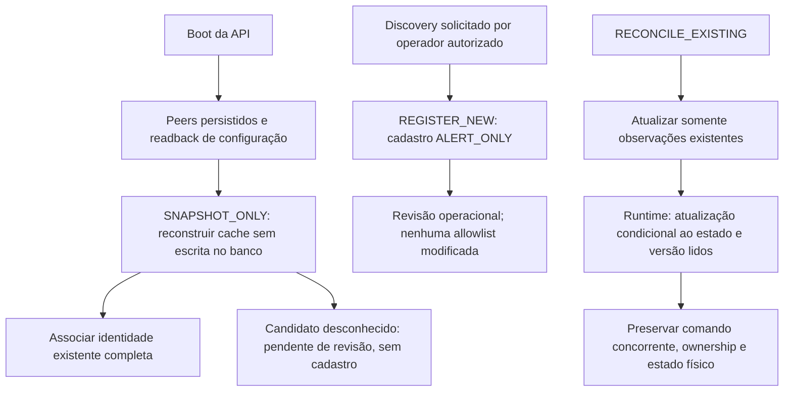
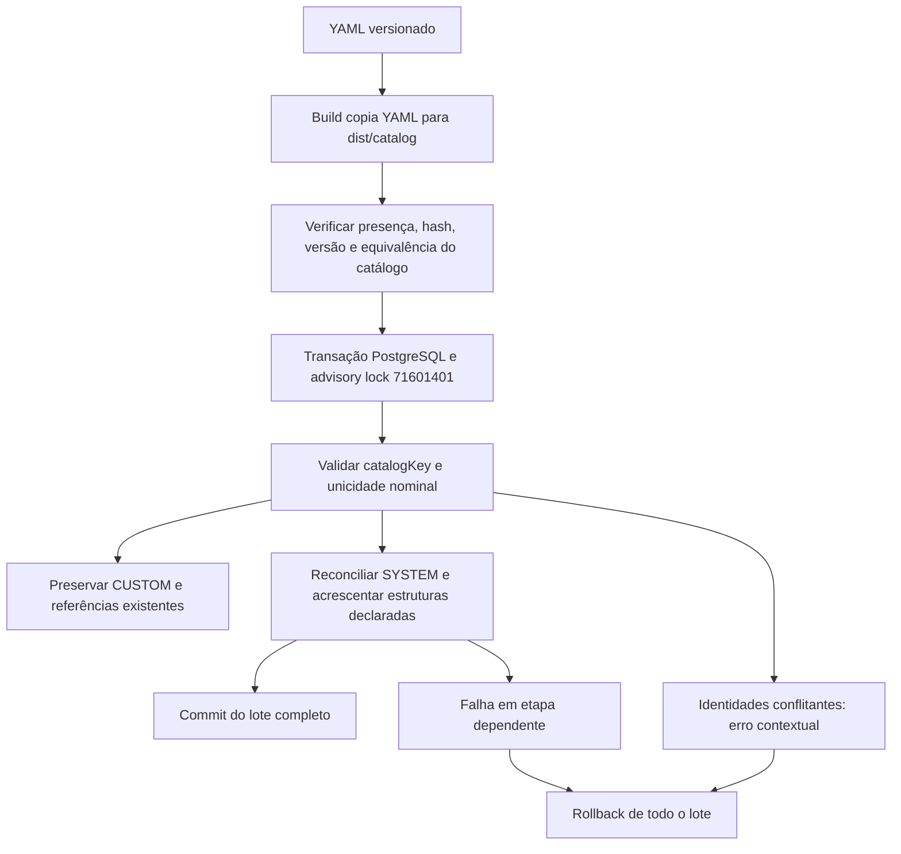
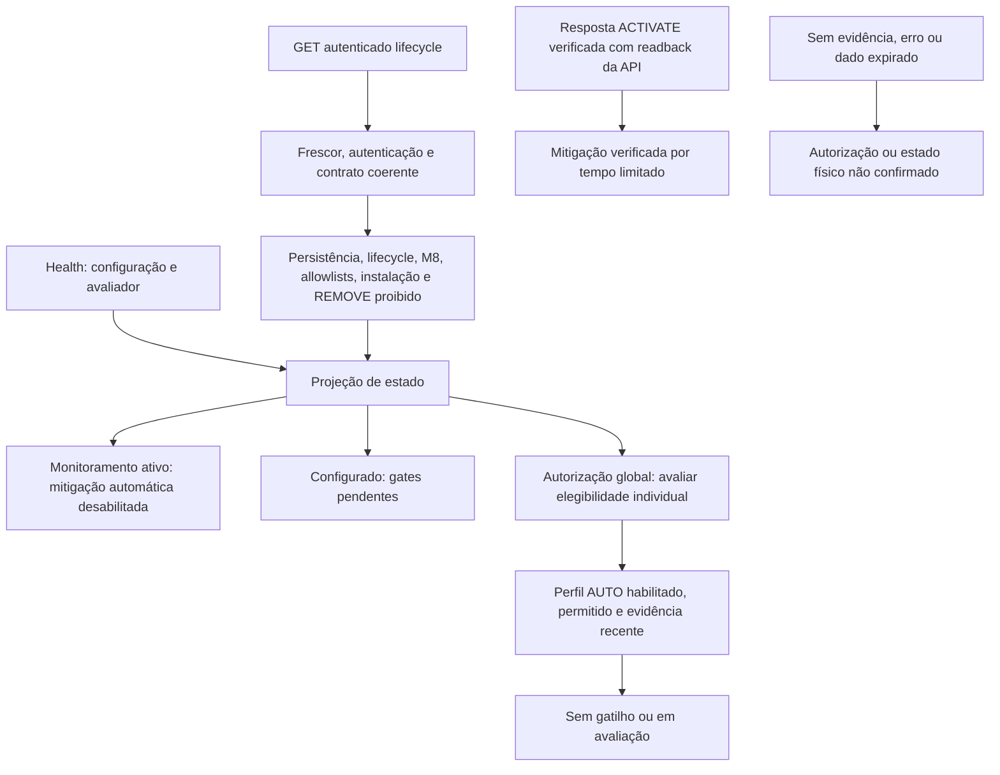

# Fase 0.1 — estabilização antes de nova publicação

Esta documentação prepara uma operação futura. Nenhum comando operacional deste documento foi executado em produção nesta missão. AUTO ACTIVATE continua desligado; REMOVE é exclusivamente manual. O relatório final na raiz registra os commits, hashes, testes e limitações.

## Fronteiras de execução

Identidade de perfil: `(deviceId, interfaceId, addressFamily, policyName)`. Policy e cliente não são chaves suficientes. Discovery não promove AUTO, não altera allowlist, não altera thresholds/exclusões/override/modo administrados e não prova ausência de nodes a partir de runtime NORMAL. Um snapshot que diverge da banda persistida perde prontidão até revisão. Snapshot substituído, ausente ou com leitura falha invalida a evidência anterior.

O cadastro explícito continua disponível. Falhas parciais de cadastro são informadas; retry repara a mesma identidade. A indicação `CREATED_REVIEW_REQUIRED` e o aviso pertencem ao resultado da descoberta, sem criar uma coluna de aprovação fictícia. Nenhuma fila durável de revisão foi introduzida. O estado seguro persistido é ALERT_ONLY; a revisão administrativa posterior permanece necessária.

## Catálogo físico e pacote

O build deve incluir `apps/api/dist/catalog/physical-catalog-v1.yaml`. Não basta transportar `server.cjs`. Execute `node scripts/verify-api-release.mjs DIRETORIO_APPS_API` sobre a árvore empacotada e confira os hashes com o manifesto aprovado. O script verifica arquivos e hashes; a aprovação deve conferir também o conteúdo YAML e a equivalência com o catálogo esperado. YAML presente e inválido continua produzindo erro explícito. O fallback de emergência continua existindo, mas não é uma fonte aceitável para publicar este pacote.

`syncCatalog` é atômico, serializado entre processos e preserva CUSTOM. Nomes iguais com chaves distintas provocam `PHYSICAL_CATALOG_NAME_CONFLICT`; não há adoção por nome, exclusão, limpeza global ou `skipDuplicates` escondendo conflitos estruturais. Repetições não alteram timestamps de metadados já iguais. Metadados SYSTEM divergentes e estruturas faltantes ainda podem ser reconciliados, portanto o próximo deploy exige uma comparação prévia em cópia descartável do banco. Os 13 templates adicionais atuais não serão excluídos pelo novo bootstrap.

Não há schema nem migration nova nesta correção. A migration de automação anteriormente aprovada permanece inalterada e não deve ser aplicada nesta fase.

## Autoridade exibida pela WEB

Lifecycle é a autoridade global. MODE=AUTO, RUNNING, HUAWEI e LIVE_WRITE=true isoladamente não autorizam AUTO. A WEB rejeita ausência de dados, falha HTTP/autenticação, contrato contraditório, autorização com mais de 30 s ou recebida no futuro. Queries de health, perfis e diagnóstico têm renovação e prazos próprios; erro com dado em cache também bloqueia a apresentação positiva. Alerta de runtime MITIGATED passa a pedir confirmação, sem badge verde de prova física. O FAST também exige decisão ACTIVATE verificada e recente para indicar MITIGATED.

Confirmação de comando manual exige resposta `ACTIVATED_VERIFIED`, `verified=true`, verificação não nula e execução Huawei real habilitada no health. Esse indicador expira em 30 s. Não é uma sondagem contínua do equipamento. Fora dessa janela a interface pede nova confirmação; não deduz ausência física a partir de NORMAL. Diagnóstico SNMP legado não substitui a medição FAST e não recebe autorização a partir da configuração global apenas.

Para perfis roteados FAST omitidos do resumo ENFORCE, a WEB pode usar `engine.decisions` já retornado pela API, sempre por profileId exato. Isso não concede autorização nem permite atribuir uma fonte à decisão sem prova. Ausência de decisão mostra estado/contadores desconhecidos; não inventa 0/3 confirmações.

A candidata WEB parte de `f4b31fc31dd0ffdc7d454157822a3e85c5a5e8b8`, preservando a responsividade publicada. Nunca empacotar a WEB histórica de e78638a como parte da atualização API.

## Pré-flight systemd corrigido

Capturar units/drop-ins efetivos, hashes, PIDs e dependências nos dois sentidos: Requires/RequiredBy, Wants/WantedBy, PartOf/ConsistsOf, BindsTo/BoundBy, Requisite/RequisiteOf, PropagatesStopTo/StopPropagatedFrom, PropagatesReloadTo/ReloadPropagatedFrom, After/Before e hooks. Seguir o fechamento transitivo dos afetados, inclusive units fora do prefixo NetVision quando referenciadas. Uma unit referenciada e não capturada é gate pendente.

`python scripts/systemd-restart-preflight.py SNAPSHOT.json` analisa o grafo capturado sem executar systemctl. O formato aceita `graph[unit].properties`. Dependências reversas de Requires também entram no cálculo. Hooks presentes exigem revisão humana; o analisador não certifica scripts arbitrários. O gate do grafo é necessário e não substitui revisão de hooks, ordenação, saúde ou versão do systemd.

O grafo atual tem `API → RequiredBy → MCP`, correspondente a `MCP Requires=API`. Restart, try-restart, stop e rollback com restart da API podem afetar o MCP. After sozinho ordena; não é a proteção contra propagação. Fundamentação: [documentação oficial systemd.unit](https://www.freedesktop.org/software/systemd/man/latest/systemd.unit.html#Requires=).

O laboratório descartável em systemd 259.9 reproduziu o reinício do MCP com restart e try-restart, parada com stop, preservação do PID em dois restarts com `ignore-dependencies` e recuperação após crash da API. A produção usa 259.5; o MCP simulado não prova o comportamento de transporte do MCP real. Os dois restarts preservando PID simulam troca/retorno de processo, sem substituir artefatos reais. Não são homologação de rollback de uma release.

**Não aprovar restart estritamente API-only com base nesse laboratório.** Não remover Requires nem aplicar um drop-in de dependências. O procedimento recomendado mantém a topologia e exige autorização explícita para janela conjunta de restart API+MCP. Alternativamente, homologar previamente o MCP real em ambiente descartável equivalente e submeter novo procedimento de isolamento à revisão. `--job-mode=ignore-dependencies` não está liberado para uso produtivo por este relatório.

## Roteiro de publicação futura — API

1. Aprovar os commits e esta auditoria; solicitar nova autorização, incluindo escopo dos serviços e efeitos esperados do bootstrap do catálogo. Se a exigência for preservar PID do MCP sem homologação adicional, parar.
2. Em Linux isolado, instalar dependências do lockfile, gerar Prisma e compilar o SHA exato. Não incluir `.env`, credenciais ou banco. Gerar pacote imutável com bundle, map, YAML, dependências Linux e cliente Prisma compatível, hash SHA256 e manifesto completo. Os builds Windows desta auditoria validam código; não são pacote Linux autorizado.
3. Validar o pacote instalado em diretório descartável e cópia sanitizada do banco. Comparar o catálogo antes/depois, inclusive os 13 templates adicionais. Não depender de bootstrap como mecanismo de limpeza.
4. Recoletar estado produtivo somente por leitura: quatro serviços, hashes, CWDs, flags efetivas e precedência dos drop-ins/EnvironmentFiles, HTTP, perfis, eventos e migrations. Comparar grafo systemd e estado aprovados. Garantir espaço para release, backups e rollback sem remover releases saudáveis.
5. Interromper se flags AUTO/persistência/lifecycle/description/remove diferirem de 0, allowlist de execução não estiver vazia, houver comando em andamento, grafo desconhecido, health degradado, migração pendente inesperada, diferença não revisada em perfil/catálogo ou alteração de bundle ativo.
6. Somente com autorização operacional: instalar nova release separada, preservar a release e configuração anteriores, preparar drop-in exclusivamente de WorkingDirectory/ExecStart e conferir sua precedência lexicográfica. Manter integralmente os EnvironmentFiles e flags da Fase 0. Não editar a release ativa. Não reaproveitar o nome de um SHA para outros bytes.
7. Autorizar explicitamente daemon-reload e a troca/restart dos serviços cobertos pela janela. Na topologia atual, solicitar janela conjunta API+MCP. Não reiniciar WEB, Observer, n8n ou outros serviços. Nenhuma alteração de dependência é necessária à proposta conservadora.
8. Conferir flags no `/proc` do novo processo, CWD e hash, API/WEB/MCP/Observer saudáveis, HTTP 200, n8n inalterado, mesmos perfis/configurações/estados relevantes/eventos/migrations. Conferir reidratação sem persistência e catálogo íntegro. Consultar lifecycle com sessão legítima disponibilizada pelo operador, sem criar sessão durante uma auditoria somente leitura.
9. Parar com AUTO desligado. Só depois solicitar revisão visual e aceitação da Fase 0. Não executar piloto AGLINK, migration/outbox ou habilitação AUTO neste roteiro.

## Publicação independente — WEB

Partir exclusivamente da candidata derivada da responsiva f4b31fc. Compilar com `NETVISION_INSTALLATION_ID=IMPLANTAR`, registrar BUILD_ID e hashes e validar o contrato contra a API efetiva. Instalar em release WEB separada mediante nova autorização WEB-only. Preservar API/MCP/Observer e suas memórias; não reiniciar API como parte da troca WEB. Conferir os 15 cenários de browser, filtros, detalhes, busca, estado com M8=0, lifecycle indisponível e responsividade. A troca operacional e aprovação visual não foram executadas nesta missão.

## Rollback e critérios de interrupção

O primeiro retorno de código proposto é para a API e78638a atualmente saudável, sem mudar os flags 0. Esse retorno reintroduz os defeitos de discovery/catalog bootstrap, portanto precisa da mesma análise prévia do banco e da janela MCP; não equivale a restaurar um snapshot de dados. Não apagar perfis/templates para compensar o boot. Não restaurar banco inteiro por rotina de rollback. O código não faz AUTO REMOVE e o processo de retorno não deve executar nenhum comando Huawei.

Se for necessário voltar até RC13, abrir revisão separada: M8=0 da RC13 não é uma barreira universal. Preparar proteção independente comprovada, incluindo `MITIGATION_LIVE_WRITE_ENABLED=false`, allowlists vazias e workers AUTO efetivamente inativos conforme a versão auditada. A flag de live write bloqueia temporariamente ACTIVATE/REMOVE manuais também; o operador deve aprovar esse impacto antes da janela. Não remover policies existentes automaticamente. Não executar downgrade RC13 com a configuração atual de escrita manual habilitada sem esse plano adicional.

Retorno WEB usa a release responsiva f4b31fc e seu BUILD_ID anterior, sem restart da API. O banner anterior volta a ser enganoso; registrar a limitação enquanto a correção é reavaliada. Nunca usar esse banner como autorização para AUTO.

Abortar a sequência se qualquer serviço não autorizado trocar PID, surgir ACTIVATE/REMOVE, mudar allowlist/mode/threshold, falhar readback, aumentar contagem de perfis durante reidratação, ocorrer erro parcial no catálogo, divergir hash aprovado, aparecer necessidade de migration ou surgir erro de auth/staleness apresentado como AUTO armado. Preservar evidência e solicitar decisão do operador; rollback também é uma operação que precisa de autorização e dos gates systemd.

## Matriz de segurança

| Condição | Apresentação/efeito exigido |
| --- | --- |
| M8=0, ainda que AUTO/HUAWEI/LIVE_WRITE/RUNNING | Monitoramento; escrita automática desabilitada |
| M8=1 com lifecycle/persistência indisponíveis | Aguardando autorização; sem AUTO armado |
| Allowlist vazia, perfil ALERT_ONLY/excluído/bloqueado | Sem autorização individual |
| Sem lifecycle, 401/403, erro, futuro ou stale | Estado não confirmado |
| Runtime MITIGATED ou NORMAL sem prova | Não afirmar presença/ausência física |
| Readback ACTIVATE real, verificado e recente | Evidência limitada ao instante verificado; REMOVE manual |
| Queda/normalização de tráfego, cooldown/recoverySamples | Nunca executar REMOVE automaticamente |
| Snapshot ausente, divergente ou substituído | Perder prontidão; não manter evidência antiga |
| Conflito de catálogo ou falha de etapa dependente | Rollback atômico do lote; erro explícito |
| API restart com RequiredBy MCP sem autorização MCP | NO-GO |

## Reproduzir verificações locais

- `python scripts/test_systemd_restart_preflight.py`.
- Laboratório: construir `scripts/systemd-lab/Dockerfile`; rodar container descartável com rede `none`, cgroup privado, tmpfs `/run`, sem bind de host, sem Docker socket e sem credenciais. `systemd-restart-lab.py` exige Docker, marcador exclusivo e `NETVISION_DISPOSABLE_SYSTEMD_LAB=1`. Requer privilégios somente no container local para executar PID 1 systemd.
- API: gerar Prisma, build, typecheck, ESLint e Vitest no worktree isolado. Há testes que inspecionam o bundle do Observer, portanto o build deve preceder a suíte.
- PostgreSQL: `mitigation-phase01-postgres.test.ts` aceita somente `NETVISION_PHASE01_TEST_DB` com host `127.0.0.1` e banco `/phase01`. Preparar schema apenas nesse PostgreSQL descartável. Nenhuma URL produtiva pode entrar no ambiente de teste.
- WEB: `npm ci` em árvore de dependências própria, build IMPLANTAR, ESLint e Vitest. A suíte histórica de snapshot pressupõe `TZ=UTC`; não alterar timezone produtivo para satisfazê-la. Os testes de browser usam API mockada e servidor local exclusivo. Esses testes não homologam Huawei, Telegram ou sessões reais.

Evidências sanitizadas em `docs/evidence/phase01/`. Coletas brutas permanecem fora do Git em diretório protegido. Não há credenciais no material versionado.
